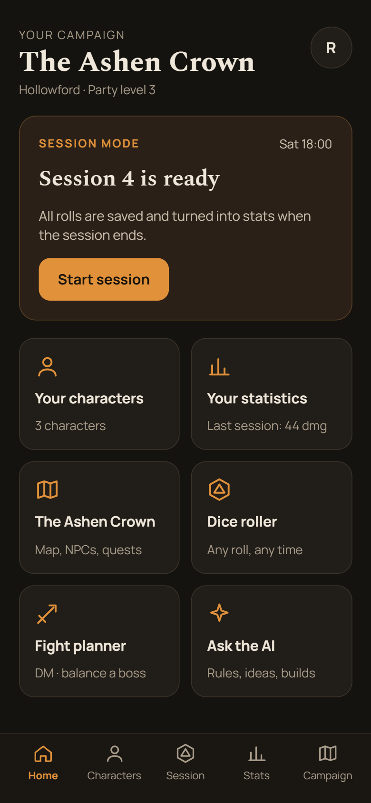
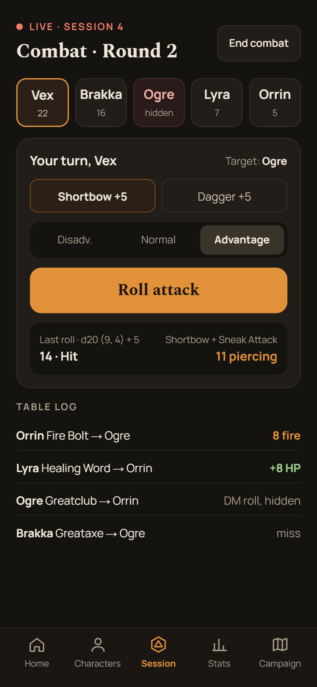
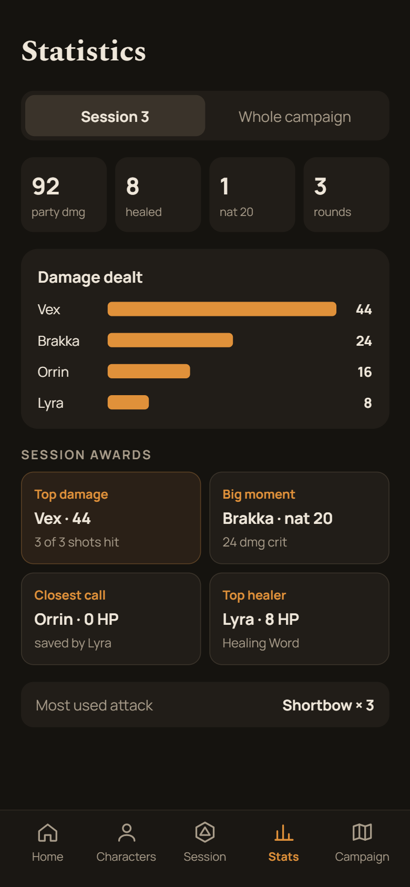
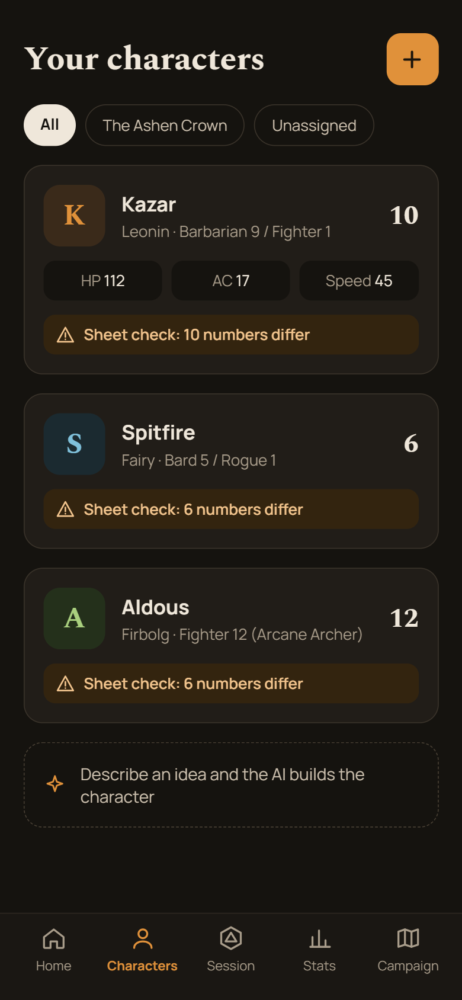
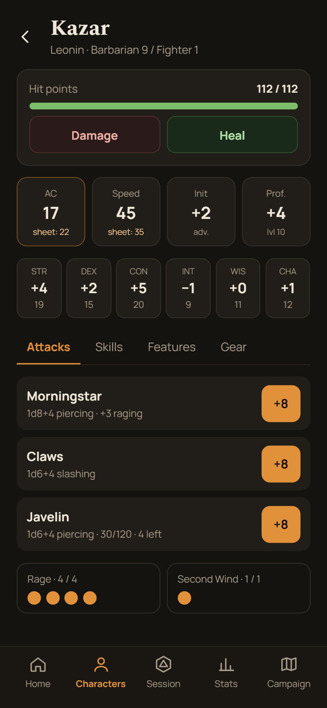
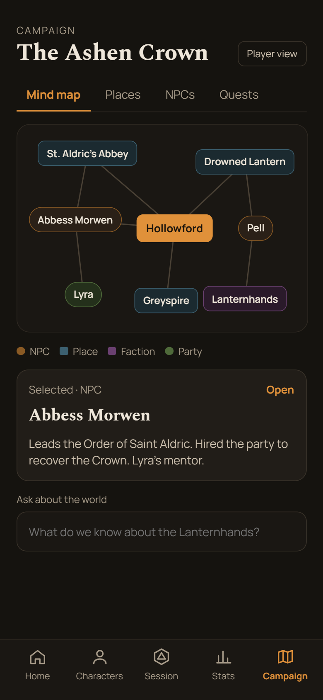

<h1 align="center">DND-ai</h1>

<p align="center">
  A companion app for a Dungeons &amp; Dragons group: characters, campaigns, sessions, fights and battle maps in one place,<br>
  plus <b>Tavern</b>, an AI rules assistant that answers from real rules text instead of from the model's memory.
</p>

<p align="center">
  
  
  
  
  
  
  
</p>

<p align="center">
  
  &nbsp;
  
  &nbsp;
  
</p>

Built with Next.js, TypeScript and Supabase (PostgreSQL). The AI layer works with any OpenAI-compatible provider and includes a pipeline for fine-tuning and self-hosting our own model.

---

## Contents

- [A quick tour](#a-quick-tour)
- [Tavern: the AI rules assistant](#tavern-the-ai-rules-assistant)
- [Other features](#other-features)
- [Tech stack](#tech-stack)
- [Running locally](#running-locally)
- [Project structure](#project-structure)
- [Credits](#credits)

---

## A quick tour

<table>
  <tr>
    <td width="33%" align="center"></td>
    <td width="33%" align="center"></td>
    <td width="33%" align="center"></td>
  </tr>
  <tr>
    <td valign="top"><b>Home.</b> The current campaign at a glance: the next session, your characters, last session's stats, the dice roller, the fight planner and the AI.</td>
    <td valign="top"><b>Your characters.</b> Every character with level, class and key numbers. A <i>sheet check</i> flags numbers on the paper sheet that don't match the rules math. Or describe an idea and let the AI build the character.</td>
    <td valign="top"><b>Character sheet.</b> HP with damage and heal, AC, speed, initiative and abilities, attacks with ready-to-roll bonuses, and tracked resources like Rage and Second Wind.</td>
  </tr>
  <tr>
    <td width="33%" align="center"></td>
    <td width="33%" align="center"></td>
    <td width="33%" align="center"></td>
  </tr>
  <tr>
    <td valign="top"><b>Session mode.</b> Initiative order, attack picker, advantage and disadvantage, one-tap rolls with damage worked out, a shared table log, and hidden DM rolls.</td>
    <td valign="top"><b>Statistics.</b> Every roll from the session becomes stats: party damage, healing, nat 20s, damage per player, session awards and most-used attacks, per session or for the whole campaign.</td>
    <td valign="top"><b>Campaign.</b> A mind map of places, NPCs, factions and the party, with a player view for the table and an "ask about the world" box backed by the campaign notes.</td>
  </tr>
</table>

---

## Tavern: the AI rules assistant

Tavern is a retrieval-augmented generation (RAG) system. The app gathers the facts and runs the rule checks. The language model only words the answer.

<!-- Add a screenshot of the Tavern chat with cited sources here:
<p align="center"></p>
-->

```
question
   │
   ▼
1. Retrieval ─── rules (SRD 5.2.1), spells, feats, class features, items, monsters,
   │             the character's sheet, the table's house rules, campaign notes
   ▼
2. Rule checks ─ app-side validation (one spell slot per turn, one bonus action,
   │             two concentration spells, spellcasting while raging…)
   ▼
3. Prompt ────── numbered sources [S1], [S2]… within a character budget + check results
   │             + the user's chosen speaking style
   ▼
4. LLM ───────── provider fallback chain (Groq → Gemini → OpenRouter… → our own model)
   ▼
answer with cited sources, saved with the user's rating for future training
```

### Retrieval
- Things named in the question ("Misty Step", "Cunning Action") are matched directly and always included.
- Everything else is ranked with **BM25** over stemmed, stop-word-filtered text.
- Results are cut to a character budget so prompts fit small, free or self-hosted models.
- Implemented from scratch and covered by unit tests (`lib/assistant/search.ts`).

### Privacy and access
- DM-only campaign notes are used only when the DM asks. They are never sent to providers marked as untrusted, and never exported as training data.
- AI tables are server-only. Supabase row-level security blocks access with a user's key.

### Provider fallback chain
- Up to 9 OpenAI-compatible providers are configured in `.env.local`, each with one or more models.
- When a provider hits its rate limit or fails, the next one answers. Exhausted providers are skipped until their limit resets.
- Provider status (remaining quota, usage today) is stored in the database and shown to the DM.

### Feedback loop and fine-tuning
- Users rate answers with 👍 / 👎. After a 👎 they can write the correct answer, which is the most valuable training data.
- The exact prompt sent to the model is stored with each answer. `scripts/export-training.mjs` exports rated conversations to JSONL.
- `training/train_tavern.py` fine-tunes **Qwen3-4B-Instruct** with **LoRA** (Unsloth, 4-bit) on a free Colab or Kaggle GPU, training only on the assistant's responses.
- The model is exported as a **q4_k_m GGUF** and served with **Ollama** (`training/Modelfile`). It plugs into the same fallback chain as any other provider.
- See `training/README.md` for the full guide and a hosting cost comparison.

<!-- If you haven't run the training yet, keep this line: -->
> **Status:** the training pipeline is ready; training data is being collected through the app.

---

## Other features

<table>
  <tr>
    <td width="50%" valign="top">
      <h3>🧙 Characters</h3>
      Sign-up, invites, claiming characters, character sheets, a sheet check against the rules math, a level-up wizard with history and undo, and AI character building from a short idea.
    </td>
    <td width="50%" valign="top">
      <h3>🎲 Dice</h3>
      3D physics dice (three.js + cannon-es), a custom dice workshop, and shared rolls the whole table sees.
    </td>
  </tr>
  <tr>
    <td valign="top">
      <h3>⚔️ Sessions and combat</h3>
      Session mode, initiative tracking, fight planner and moderator, rests, concentration, secret saves and hidden DM rolls.
    </td>
    <td valign="top">
      <h3>🗺️ Battle maps</h3>
      Grid fitting, turn-based movement and area spells on the map.
    </td>
  </tr>
  <tr>
    <td valign="top">
      <h3>📜 Campaigns</h3>
      Campaign vault with folders and a rich-text editor (Tiptap), a mind map of places, NPCs and factions, a player view, and AI reading of campaign notes.
    </td>
    <td valign="top">
      <h3>📊 Statistics</h3>
      Party and character stats per session and across the campaign, with charts (Recharts) and session awards.
    </td>
  </tr>
  <tr>
    <td valign="top">
      <h3>🛡️ Items and shops</h3>
      2014 and 2024 item libraries.
    </td>
    <td valign="top">
      <h3>🎨 Themes</h3>
      Themes and animations across the app.
    </td>
  </tr>
</table>

---

## Tech stack

| Area | Tools |
|---|---|
| Frontend | Next.js 16, React 19, TypeScript, Tailwind CSS 4 |
| Backend and data | Supabase (PostgreSQL, Auth, row-level security), Next.js server actions |
| AI | OpenAI-compatible APIs (Groq, Gemini, OpenRouter), custom BM25 retrieval |
| Fine-tuning | Python, Unsloth, Hugging Face TRL, LoRA, GGUF, Ollama |
| 3D and charts | three.js, cannon-es, Recharts |
| Testing | Vitest |

## Running locally

1. Clone the repo and install dependencies:
   ```bash
   npm install
   ```
2. Create a Supabase project and run the SQL files in `supabase/` in numeric order.
3. Create `.env.local` with your Supabase URL and keys, and at least one AI provider (see `lib/ai/env-example.txt`).
4. Start the dev server:
   ```bash
   npm run dev
   ```
5. Run the tests:
   ```bash
   npx vitest
   ```

## Project structure

```
app/              Next.js routes (tavern, characters, campaign, fights, maps, session, stats…)
lib/assistant/    Tavern: retrieval, rule checks, prompt building, speaking styles
lib/ai/           provider chain, rate-limit tracking, OpenAI-compatible client
supabase/         database schema, row-level security and seed data, in run order
training/         fine-tuning script, Ollama Modelfile, training guide
scripts/          training data export
docs/screenshots/ images used in this README
```

## Credits

Rules text from the System Reference Document 5.2.1 by Wizards of the Coast, licensed under CC BY 4.0.
